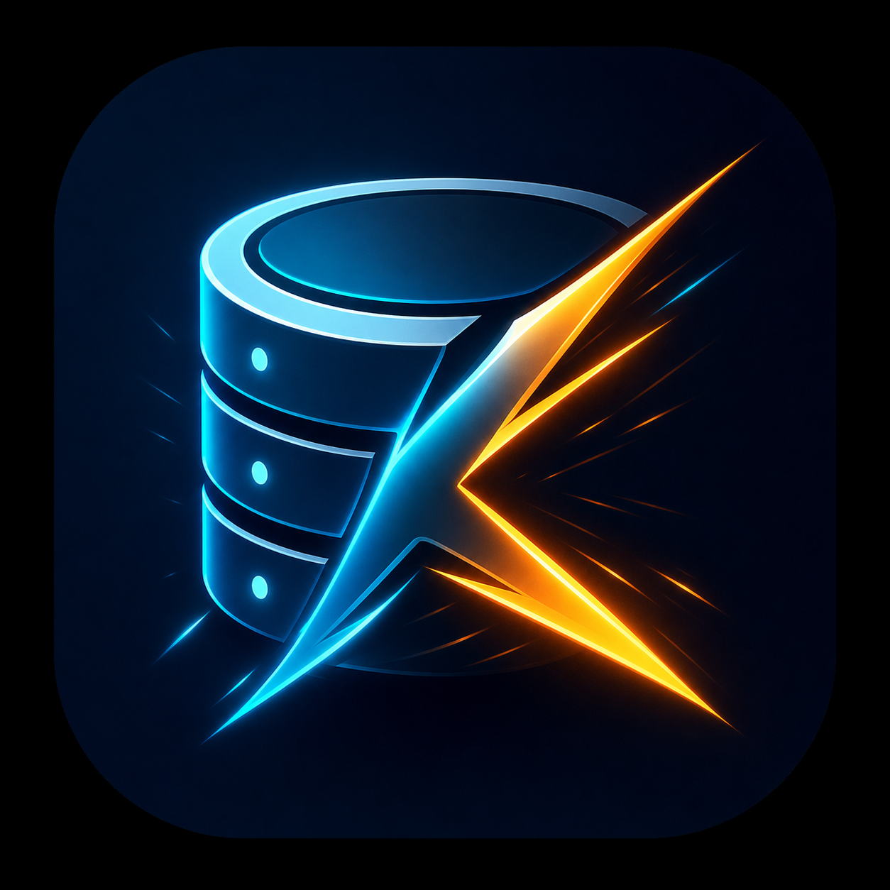

# KamehaDB

<p align="center">
  <a href="https://kamehadb.astalife.co">
    
  </a>
</p>

**KamehaDB** is a local-first, cross-platform desktop database workspace that connects to PostgreSQL, MySQL, MariaDB, SQLite, SQL Server, Oracle, ClickHouse, DuckDB, MongoDB, and Redis — browse schemas, run queries, chat with AI, capture schema history, and generate migrations, all in one lightweight Wails app with an embedded Go backend.

## Features

- **10 engines, one app** — SQL, document, and cache systems side by side: PostgreSQL, MySQL, MariaDB, SQLite, SQL Server, Oracle, ClickHouse, DuckDB, MongoDB, Redis
- **Local-first** — All metadata stored locally in a SQLite database; no hosted proxy, no telemetry. Remote AI providers receive your conversation and the relevant schema context directly from the app; local Ollama stays on-device
- **Small and fast** — single Go binary with an embedded backend; no sidecar process, no Node runtime, fast builds
- **AI with real schema context** — multi-provider chat (OpenAI, Ollama local + cloud, 9Router, DeepSeek, Gemini) reads your actual DDL, indexes, and constraints to generate SQL, MongoDB pipelines, and Redis commands. Generated SQL is shown for review and never executed by the chat flow. Streaming responses with stop/cancel
- **ACP agent chat backend** — optionally run chat through a fixed local Agent Client Protocol CLI (Codex, Claude, OpenCode, or Devin) instead of a KamehaDB provider. The agent reads your schema and can query enabled connections read-only through MCP, using a per-turn scoped token, with tool permission prompts shown in the chat
- **Read-only MCP server** — let Codex, Claude Code, Devin CLI, and OpenCode inspect schemas and run read-only SQL/Mongo queries against opt-in connections over a local `127.0.0.1` endpoint secured with a bearer token
- **Schema timeline + diff + migration assistant** — capture on-demand snapshots, compare schemas side by side with per-table change cards (columns, indexes), and auto-generate DDL to migrate from one state to the next
- **Global search (Ctrl+K)** — fuzzy search across connections, tables, columns, open tabs, and quick actions across every connected engine
- **Engine-native tooling** — PostgreSQL stats and embedded PSQL terminal, MongoDB explorer with chart view, Redis key browser
- **Query history with favorites** — normalized patterns, duration per group, per-connection
- **Charts** — bar, line, area, pie views on any query result or Mongo collection (powered by recharts)
- **Health monitoring** — live status badges with latency tracking; slow/reconnecting/offline states with tooltips
- **Schema browser & ER diagram** — auto-generated ER graphs via ReactFlow + dagre
- **Pin & workspace memory** — pinned connections and open tabs persisted to localStorage and restored on refresh
- **Schema-aware SQL editor** — CodeMirror 6 with FK-aware JOIN/ON suggestions and autocomplete across tables, columns, functions, keywords
- **Embedded mongosh terminal** — interactive mongosh session with full PTY, ANSI colors, resize, and persistence across tab navigation
- **Connection URL** — paste `postgresql://`, `mysql://`, `redis://`, etc. to auto-fill connection fields

## Quick Start

```bash
# Install dependencies
pnpm install

# Start dev services
docker compose up -d

# Run the app (Wails dev mode — Go backend + Vite frontend)
pnpm dev
```

Then open the desktop app, create a new connection pointing at `localhost`, and start exploring.

### AI Setup

Configure AI providers in the app settings (API Settings page):

| Provider       | Default Model   | Notes                                    |
| -------------- | --------------- | ---------------------------------------- |
| Ollama (local) | `llama3.2`      | Uses `http://localhost:11434` by default |
| Ollama (cloud) | —               | Requires base URL and API key            |
| OpenAI         | `gpt-4o`        | Requires API key                         |
| 9Router        | Any model       | Requires base URL and API key            |
| DeepSeek       | `deepseek-chat` | Requires API key                         |
| Gemini         | —               | Requires API key                         |

### Read-only MCP setup

KamehaDB runs a read-only Model Context Protocol server on `http://127.0.0.1:13979/mcp`
while the app is open. Local AI clients can inspect schemas and run bounded
queries through a dedicated database account that KamehaDB provisions for the
selected database.

1. Create a normal connection profile with credentials that can create users
   and grant read access on its selected database.
2. Open **API Settings → MCP Server** and choose **Create read-only account**.
   KamehaDB grants only read access on that database and stores the generated
   credential encrypted in its local SQLite metadata store, with the vault key in
   the OS keychain and an owner-only key file as a fallback. Existing accounts
   created by older Keychain-backed versions must be revoked and recreated.
   SQLite keeps its existing read-only file connection and does not need a
   database account.
3. Enable the profile, then copy the generated snippet for Codex, Claude Code,
   Devin CLI, or OpenCode into its config. Snippets include the endpoint and
   bearer token.

The MCP listener binds only to loopback, uses a persistent token you can rotate,
and stops when KamehaDB closes. MCP queries always use the generated read-only
credential; they never fall back to the profile credential. Disabling MCP keeps
the database account. Revoke it explicitly before changing the profile's
database target or credentials, or deleting the profile. MongoDB account setup
requires server authentication to be enabled. If the fixed port is in use, MCP
is unavailable until you free it or choose another port — KamehaDB keeps
working either way. Aggregations with `$out`/`$merge`, write statements, and
non-enabled profiles are rejected. See
[`docker-init/MCP-READONLY.md`](./docker-init/MCP-READONLY.md) for local
database-grant test fixtures.

### Connection defaults (Docker)

| Engine     | Port  | User    | Password | Database |
| ---------- | ----- | ------- | -------- | -------- |
| PostgreSQL | 5432  | kameha  | kameha   | kamehadb |
| MySQL      | 3306  | kameha  | kameha   | kamehadb |
| MariaDB    | 3307  | kameha  | kameha   | kamehadb |
| Redis      | 6379  | —       | —        | —        |
| MongoDB    | 27017 | —       | —        | —        |
| SQL Server | 1433  | sa      | Kameha1! | kamehadb |
| Oracle     | 1521  | SYS     | oracle   | ORCLPDB1 |
| ClickHouse | 8123  | default | default  | kamehadb |
| DuckDB     | 5433  | —       | —        | —        |

## Project Structure

```
kamehadb/
├── apps/
│   └── desktop/          # React 19 frontend (Vite, Tailwind v4) — Wails webview
├── internal/             # Go backend: adapters, services, store, MCP, terminal
├── packages/
│   └── shared/           # Shared Zod schemas and frontend-facing types
├── main.go / app.go      # Wails entrypoint
├── landing/              # Next.js marketing & docs site (managed with npm, separate lockfile)
├── docker-compose.yml    # Dev databases
└── docker-init/          # Seed SQL scripts for dev databases
```

## Running Tests

```bash
pnpm test       # frontend (vitest)
pnpm test:go    # Go backend suite
```

## Contributing

See [CONTRIBUTING.md](./CONTRIBUTING.md) for development setup, project conventions, verification requirements, and pull request guidance.

## macOS Gatekeeper

Unsigned macOS builds can still be used for local testing, but Gatekeeper may show messages such as `"KamehaDB" is damaged and can't be opened` or `"KamehaDB" cannot be opened because Apple cannot check it for malicious software`.

If you only need to test the app on your own Mac, try one of these:

1. Right-click `KamehaDB.app`, choose `Open`, then confirm.
2. Remove the quarantine attribute after copying the app to `Applications`:

```bash
xattr -dr com.apple.quarantine /Applications/KamehaDB.app
```

If the app is still being run directly from the mounted DMG:

```bash
xattr -dr com.apple.quarantine "/Volumes/KamehaDB/KamehaDB.app"
```

You can also disable Gatekeeper globally with `sudo spctl --master-disable`, but that is broader than necessary and should not be left enabled long-term.

### Build for Local Machine

```bash
# Native build for the current platform (output in build/bin/)
pnpm build

# Cross-platform targets
wails build -platform darwin/universal   # macOS universal .app
wails build -platform linux/amd64        # Linux binary
wails build -platform windows/amd64      # Windows .exe
```

## Tech Stack

- **Desktop**: Wails v2 (Go + native webview), React 19, Vite, Tailwind CSS v4, Base UI (`@base-ui/react`), TanStack (Query, Store, Table)
- **Editor**: CodeMirror 6, custom SQL autocomplete with FK-aware JOIN/ON hints, markdown rendering with `react-markdown`
- **Backend (Go)**: pgx (PostgreSQL), go-sql-driver (MySQL/MariaDB), modernc.org/sqlite, go-mssqldb (SQL Server), go-ora (Oracle), clickhouse-go, go-duckdb, mongo-driver, go-redis
- **Graph**: ReactFlow (`@xyflow/react`), dagre auto-layout
- **AI**: Multi-provider abstraction (OpenAI, Ollama local/cloud, 9Router)

## Roadmap

### Currently Supported

- [x] PostgreSQL
- [x] MySQL
- [x] SQLite
- [x] MongoDB
- [x] Redis
- [x] Data export (CSV, JSON, SQL)
- [x] SQL Server
- [x] Oracle
- [x] ClickHouse
- [x] DuckDB
- [x] MariaDB

### Features

- [x] Query history with favorites
- [x] Data visualization / charts
- [x] Connection health monitoring
- [x] Global search (Ctrl+K)
- [x] Pin / favorites connections
- [x] Workspace tabs memory
- [x] Production safety mode — prevent accidental writes to production
- [x] PostgreSQL backup & restore
- [x] PostgreSQL embedded PSQL tool
- [x] Schema change timeline — capture on-demand snapshots, see what changed, and auto-generate DDL to migrate between states
- [x] Migration assistant

### Future Ideas

- [ ] Collaboration features

## License

Apache-2.0 — see [LICENSE](./LICENSE).
